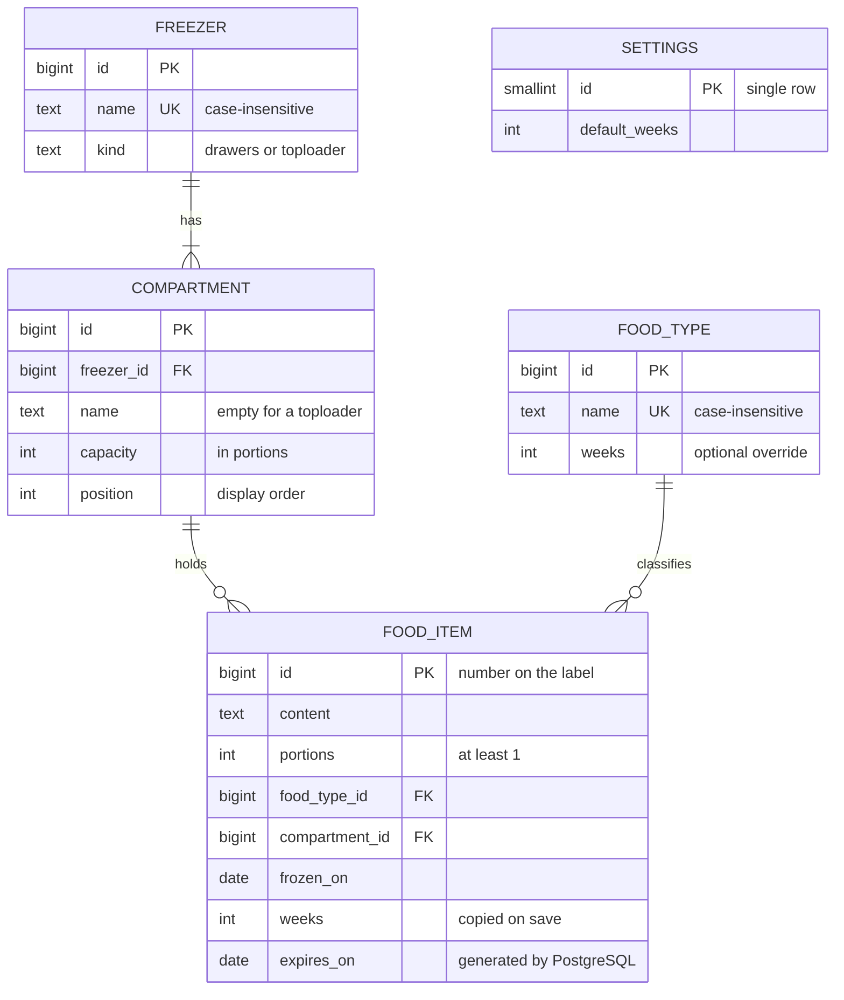

# FoodDate: implementation plan

Status: **approved on 22-11-2026**. Progress is tracked in the milestone issues and pull requests.

A web app to track leftover food in one or more freezers: what it is, where it is, and when
to eat it by.

## 1. Decisions

D2 and D5 were decided explicitly. For the others the default was approved.

| # | Question | Decision | Alternative and its impact |
|---|---|---|---|
| D1 | Does "labeled" mean a printed sticker? | On-screen label with a short number to write on the container | Printed labels: adds a milestone, and I need your printer and label size |
| D2 | What does capacity count? | **Decided: portions** | - |
| D3 | Where are the weeks configured? | One global default, optionally overridden per food type | Global only: slightly simpler |
| D4 | Who uses it, from where? | Your household, on laptop and phones on home Wi-Fi, with one shared login | Laptop only: no login. Internet: adds hosting and HTTPS |
| D5 | Is the repository public or private? | **Decided: public**, as the repository was created | - |
| D6 | What does "GitHub integration" cover? | Repository, issues, pull requests, CI, dependency updates | If you meant a feature inside the app, tell me what it should do |
| D7 | Can part of a container be eaten? | Yes: take out some portions, delete the record at zero | All or nothing: one button, but a partly eaten container must be edited by hand |

## 2. Requirements

| # | Your requirement | How it is met | Milestone | Done when |
|---|---|---|---|---|
| R1 | Python with PostgreSQL | Django and PostgreSQL | M0 | App and tests run on PostgreSQL |
| R2 | One or more freezers | Add, rename and remove freezers | M1 | Two freezers work side by side |
| R3 | Named drawers with a capacity each | Drawer editor, capacity in portions | M1, M2 | With 8 of 10 portions used, 2 more fit and 3 are refused |
| R4 | Toploader without drawers | Freezer type with a single capacity in portions | M1 | No drawer is shown or asked for |
| R5 | Content and food type | Free-text content, food type from an editable list | M2 | Both are required and on the label |
| R6 | Date and expiration date from configured weeks | Date defaults to today, expiration is calculated | M2 | 22-11-2026 + 12 weeks = 14-02-2027 |
| R7 | Location, with freezer only if more than one | Drawer always, freezer name only with two or more | M2 | All four cases in section 4 pass |
| R8 | Search by existing food types and expiration date | Type list from current stock, expiration filters | M3 | Filters work alone and combined |
| R9 | Delete when consumed | "Consumed" takes out portions and deletes at zero | M2 | 4 minus 1 leaves 3, taking those 3 deletes the row |
| R10 | GitHub repository named FoodDate | See section 8 | M0 | Folder is connected (done) and CI is green |
| R11 | Professional, lean, good-looking and responsive on mobile | See "Look and feel" in section 6 | All | Every screen passes at 320, 375, 768 and 1280 px |

## 3. Technology

| Part | Choice | Reason |
|---|---|---|
| Language | Python 3.13, managed with uv | Both are already installed |
| Framework | Django 5.2 LTS | Forms, migrations and login are built in |
| Interface | Server-rendered pages, mobile first | Usable at the freezer, no JavaScript build |
| Database | PostgreSQL 17 in Docker Compose | The image is already on this Mac |
| Database port | **5433** | Another project's container uses 5432 and stays untouched |
| Quality | pytest, Ruff | Tests run on PostgreSQL, not SQLite |

## 4. Rules

**Location**

| Freezers | Type | Location shown | Form asks for |
|---|---|---|---|
| 1 | Drawers | `Top drawer` | Drawer |
| 1 | Toploader | *(none)* | Nothing |
| 2+ | Drawers | `Kitchen / Top drawer` | Freezer and drawer |
| 2+ | Toploader | `Garage` | Freezer |

**Expiration**

- The weeks come from the food type if set, otherwise from the global default (12).
- The weeks are copied onto the item, so a later settings change does not alter food already frozen.
- Changing an item's date recalculates its expiration. Changing its type also refreshes its weeks.
- An item is expired from the day after its expiration date.

**Capacity**

- Capacity is counted in portions, for each drawer and for each toploader.
- Every container has a whole number of portions, at least 1 (default 1).
- Used capacity is the sum of those portions. The form shows how many are free per location.
- Adding, editing or moving is refused by the server if the portions do not fit.
- A container is never split over two locations automatically.
- Two people saving at the same time cannot exceed the capacity together.
- Capacity cannot be set below the portions already there.
- Identical containers can be added at once: 3 containers of 2 portions need 6 free portions and
  create three records, or none if they do not all fit.

**Consuming and deleting**

- "Consumed" asks how many portions, with all of them preselected.
- Taking out some lowers the count and frees that capacity. Dates and number stay the same.
- Taking out all permanently deletes the record after confirmation. No history is kept.
- A double tap, or a second person on an outdated screen, cannot subtract twice.
- A freezer or drawer holding food, or a food type in use, cannot be deleted.

## 5. Data model



A toploader is stored as a freezer with one unnamed compartment, so capacity, search and
moving food work the same for both freezer types.

Starter food types: Pasta, Burrito, Potato mash, Curry, Soup, Stew, Rice, Other.

## 6. Screens

| Screen | Purpose |
|---|---|
| Stock (home) | Soonest expiration first, filters, expired and expiring items highlighted, Consumed button |
| Add / edit food | Content, type, date, location, portions per container, number of containers, expiration preview |
| Label | The details of one container, including its current portions |
| Freezers | Freezers and drawers, with used and total portions |
| Settings | Default weeks, food types and their overrides |

```
+--------------------------------------+
| FoodDate                     [+ Add] |
| Type [All v]   Expires [Any v]       |
|--------------------------------------|
| #41  Chicken tikka           EXPIRED |
| Curry | Kitchen / Top drawer         |
| 2 portions                           |
| 27-08-2026 -> 19-11-2026  [Consumed] |
|--------------------------------------|
| #57  Bolognese                6 days |
| Pasta | Garage                       |
| 4 portions                           |
| 05-09-2026 -> 28-11-2026  [Consumed] |
+--------------------------------------+
```

Expiration filters: expired, within 7, 14 or 30 days, or a custom date range.
Dates display as DD-MM-YYYY and the interface is in English.

### Look and feel

- **Professional:** restrained colors, consistent spacing and type, plain wording, no decoration
  that does not help the task.
- **Lean:** server-rendered HTML and one hand-written stylesheet. No CSS framework, web fonts or
  external assets. JavaScript only where HTML cannot do the job.
- **Mobile first:** one column on phones, using the extra width on tablets and desktops. No
  horizontal scrolling from 320 px up, and respects notches and home indicators.
- **Touch:** controls are at least 44 px high, inputs at least 16 px text so iOS does not zoom.
- **Readable:** light and dark mode follow the device, text contrast meets WCAG AA, zoom stays
  enabled, focus is visible and status is never shown by color alone.

## 7. Project layout

```
.
├── .github/            CI workflow, Dependabot, PR template
├── config/             Django settings and URLs
├── inventory/
│   ├── models.py       tables and constraints
│   ├── services.py     capacity, expiration, move, consume
│   ├── selectors.py    stock search and occupancy
│   ├── forms.py
│   ├── views.py
│   ├── migrations/
│   ├── templates/
│   └── static/
├── scripts/            local setup
├── tests/
├── compose.yaml
├── pyproject.toml
├── .env.example        the real .env is never committed
└── README.md           setup, usage, backup and restore
```

## 8. GitHub

- Repository [`Poehee/FoodDate`](https://github.com/Poehee/FoodDate): public, default branch `main`.
- The project folder is a checkout of that repository.
- One issue and one pull request per milestone. You review and merge.
- CI on every pull request: Ruff, missing-migration check, pytest against PostgreSQL 17.
- Dependabot for Python packages and GitHub Actions.
- Branch protection on `main`, set up in M0: changes go through a pull request with green CI.
- New commits from the project folder use a GitHub noreply address.
- The repository is public, so passwords, `.env` files, database dumps and real inventory data are
  never committed. Tests use invented data.

## 9. Milestones

| # | Delivers | Verified by |
|---|---|---|
| M0 | Skeleton, database, CI, branch protection | Green CI and a page served locally |
| M1 | Freezers, drawers, toploaders, capacity | Constraint tests, browser check |
| M2 | Food types, weeks, add, edit, move, label, consume | Date, location and portion tests, two-user race tests |
| M3 | Search and filters | Boundary-date tests, browser check at phone width |
| M4 | Login, home network access, backup and restore | Test from a second device (by you), restore into an empty database |

## 10. Risks

| Risk | Handling |
|---|---|
| The app is available only while this Mac and Docker run | Accept for now, or move it to an always-on device later |
| Plain HTTP on home Wi-Fi | Acceptable at home, never port-forward it |
| Data loss | Named Docker volume and a documented `pg_dump` backup |
| A written location goes stale after a move or a second freezer | The app is authoritative, find the container by its number |
| A written portion count goes stale after eating part | Write only the number on the container, the app has the count |

## 11. Out of scope

Barcode or QR scanning, notifications, consumption history, nutrition data, native mobile
apps and multiple households.

## 12. Checked while planning

The core schema was run on a throwaway PostgreSQL 18 instance, since stopped:

- 22-11-2026 + 12 weeks generated 14-02-2027.
- A duplicate food type in different case was refused.
- A second compartment without a name in the same toploader was refused.
- A freezer holding food could not be deleted, and could be once emptied.

The portion rules were run the same way:

- Two simultaneous adds, edits or moves could not exceed the capacity.
- An exact fill was accepted and zero portions was refused.
- A duplicated "take out 1 of 4" left 3, and taking out all deleted the row.

Not yet checked: the same on PostgreSQL 17, and the Django implementation of it.
